# ScriptCAD

A browser-based CAD interface on top of NVIDIA's open-source **USD BRep** kernel
(`usd-brep`, the SMLib NURBS solid modeler, Apache-2.0, released October 2026).

There are two ways to model, and both use the same viewport:

- **Model** is a parametric feature history: primitives, sketch extrude/revolve,
  booleans, fillet/chamfer on picked edges, shell with picked faces, offset,
  move/copy, linear and circular patterns, and STEP and USD BRep import. When you edit a
  feature, everything after it regenerates.
- **Script** is plain Python against the kernel (`sm` = `usd_brep`, `show(brep)`
  to display), with `sm.` autocompletion. **From history** turns the feature
  tree into the equivalent script. That works because the history is compiled
  to exactly that code.

Exports: STEP (AP214), exact BRep as OpenUSD (`.usda` / `.usdc`, `BrepArray` prims),
tessellated `UsdGeomMesh`, and STL.

**Try it online:** [huggingface.co/spaces/mcsnekkeh/scriptcad](https://huggingface.co/spaces/mcsnekkeh/scriptcad)
(Chrome or Edge on a computer; it opens with the chair below, press **Run all** and then
**Carve**. The online demo has no Script tab or voice; install it for everything.)

## Carve: the stiffest shape for its weight

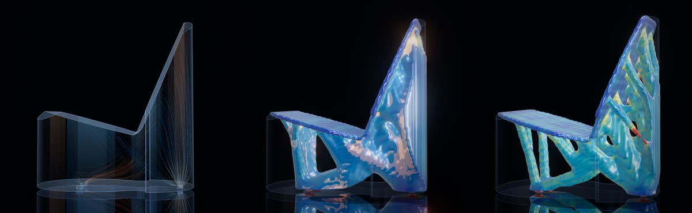

**Carve** takes a solid part, the faces it stands on and the faces that carry the load, and
removes the material that does the least work, step by step, until a share you choose is
left (for example 18%). Every step is a real stress solve on your GPU. What is left is the
shape with the most stiffness for its weight, and it tends to grow into organic, bone-like
structures. Uses: lighter parts, less material and so lower cost, and shapes to 3D print
(**Download STL**).

**The chair from the video** started as an attempt to recreate Joris Laarman's
[Bone Chair](https://www.jorislaarman.com/work/bone-chair/) (2006), itself designed with a
bone-growth algorithm. It is ScriptCAD's own result, not a copy:

| | Mass (aluminium) | Deflection | Stiffness per gram |
|---|---:|---:|---:|
| The block | 318 kg | 1.43 µm | 1× |
| Carved to 18% | 57.3 kg | 2.86 µm | **2.8×** |

<p>
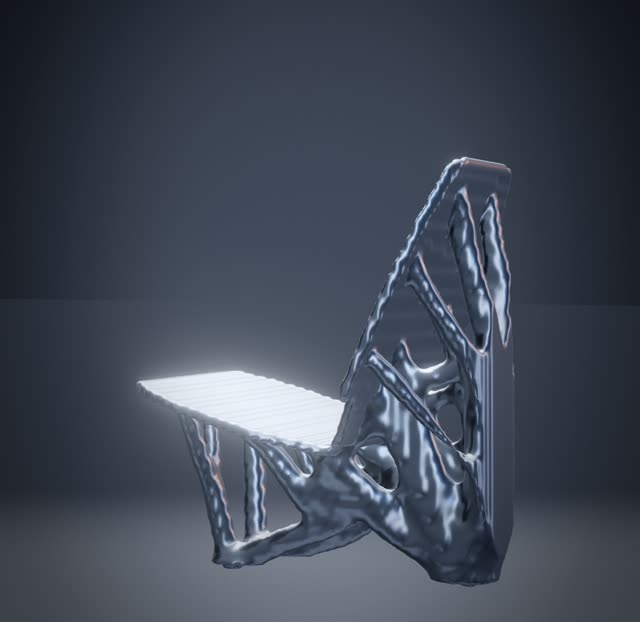
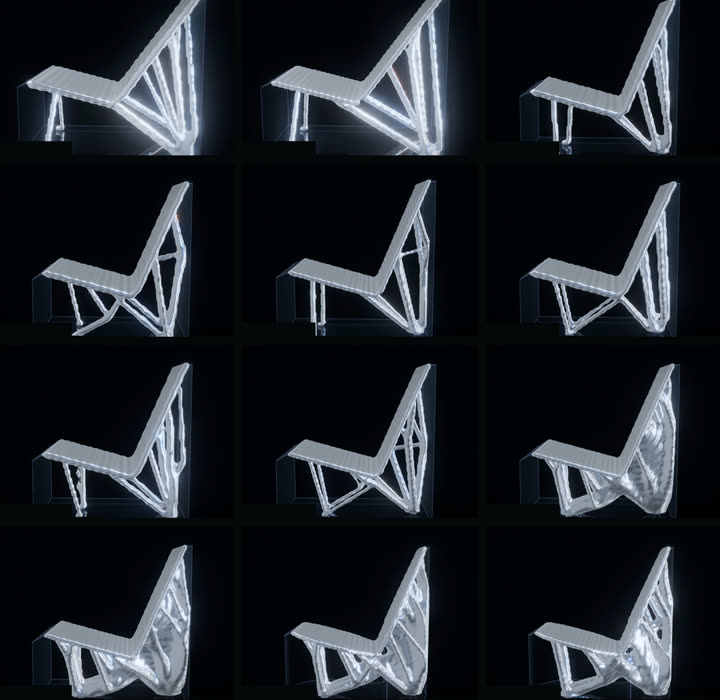
</p>

The variants on the right were made on the way, by changing where the feet are, how the load
leans, how much material is kept and how thin a member may be. Small changes in supports give
very different structures.

**Try it** (install below):

1. **File → Load Bone-inspired chair (carve, as in the video).** Analyze opens with the feet
   as supports and the seat and back as the loaded faces.
2. **Run all** solves the block (about a second).
3. In the right panel, under *Remove unused material*, press **Carve**. At *Fine* resolution
   this takes about 5 minutes on an RTX 5070 (65 solves); the viewport shows every step.
4. **Download STL** for the result.

Good to know: the result is a voxel mesh, not editable features, so use it to redraw the part
or print it. Carve optimises stiffness for one load case; it does not check strength or
buckling. The loaded seat and back stay as plates, because material at supports and loads is
always kept. The renders in the video are smoothed for display; the mesh in the app is the
carve's own surface. Details: [Remove unused material](#remove-unused-material-let-the-load-decide-the-shape).

ScriptCAD is built on NVIDIA's open-source SMLib kernel (USD BRep), and it is free and open
source.

## Install and run

ScriptCAD runs on **Windows (x86_64) and Linux (x86_64, aarch64)** with CPython
3.12, because those are the only builds of `usd-brep`. **macOS isn't supported.**
Analyze and Carve need a browser with WebGPU (a recent Chrome or Edge).

ScriptCAD isn't on PyPI yet: install it from GitHub. With
[uv](https://docs.astral.sh/uv/) you don't need a Python 3.12 install first, because uv
fetches one:

```bash
uvx --python 3.12 --from "scriptcad[sim] @ git+https://github.com/rubenhekkens/scriptcad" scriptcad
```

Or with pip in a Python 3.12 environment:

```bash
pip install "scriptcad[sim] @ git+https://github.com/rubenhekkens/scriptcad"
scriptcad
```

The `[sim]` extra is what Analyze and Carve need on the server; leave it out for modelling only.

The browser opens at http://127.0.0.1:8765. Options: `--port 9000`, `--no-browser`.
To change the per-request kernel timeout (default 90 s), set `SCRIPTCAD_TIMEOUT`.
Imported USD files are copied to a per-user data folder: `%LOCALAPPDATA%\scriptcad\uploads`
on Windows, `~/.local/share/scriptcad/uploads` on Linux.

### STEP import and export

STEP support is optional. It needs OpenCASCADE, which ships as a separate wheel:

```bash
uvx --python 3.12 --from "scriptcad[step,sim] @ git+https://github.com/rubenhekkens/scriptcad" scriptcad
```

Then use **File → Import STEP or USD BRep…** (`Ctrl+I`) and **File → Export STEP**.
Each solid in a STEP file becomes an editable body.

How it works:

- **Import:** OpenCASCADE reads the STEP file. NVIDIA's `occt_to_usd`
  converter then turns each solid into the kernel's USD BRep format.
- **Export:** ScriptCAD's own exporter (`occt_bridge.py`) rebuilds each body from
  the kernel's exact curves and surfaces in OpenCASCADE and writes AP214 STEP.

NVIDIA's converter isn't in the `usd-brep` wheel. On first STEP import,
ScriptCAD downloads a prebuilt copy for Windows x86_64 or Linux x86_64, about
46 MB. It's Julia's [BinaryBuilder](https://github.com/JuliaPackaging/Yggdrasil)
build of NVIDIA's usd-brep v1.0.0 source, plus its OpenUSD, oneTBB and C++
runtime libraries. ScriptCAD pins every download by sha256 and unpacks it into
the per-user data folder. To download ahead of time, run
`scriptcad --install-step-tools`. To use your own build of usd-brep's tools
instead, set `SCRIPTCAD_OCCT_TOOLS` to the folder containing `occt_to_usd`.

Known limits of the v1.0.0 converter:

- Some analytic faces fail to translate, for example the apex of a pointed cone.
  ScriptCAD retries those parts with every surface converted to NURBS and warns
  when it does. The geometry stays exact, but faces lose their analytic type.
- NVIDIA reports planar faces bounded by rational B-spline edges importing about
  0.65% too large ([usd-brep#11](https://github.com/NVIDIA-Omniverse/usd-brep/issues/11)).

### From source

```bash
git clone https://github.com/rubenhekkens/scriptcad
cd scriptcad
uv sync          # creates .venv with Python 3.12 and the dev tools
uv run scriptcad
uv run pytest
```

## Using it

| | |
|---|---|
| Orbit / pan / zoom | left drag / right or middle drag / wheel |
| Selection filter | `1` body, `2` face, `3` edge (Shift/Ctrl-click to add) |
| Fit view | `F` |
| Measure | `M`, then click two points |
| Confirm / cancel a feature | `Enter` / `Esc` |
| Undo / redo | `Ctrl+Z` / `Ctrl+Y` |
| Save / open project (`.scad.json`) | `Ctrl+S` / `Ctrl+O` |
| Run script | `Ctrl+Enter` |

To pre-fill a feature, select edges before you press **Fillet** or **Chamfer**,
or select two bodies before you press a **Combine** tool. While you pick edges
or faces for a feature, the model rolls back to the state just before that
feature.

**Variables** (left panel) are named numbers, such as `tf = 3`. Any number field
takes an expression over them (`40 - tf`, `bf / 2`, `max(tw, 2)`), and so does each
coordinate of a polyline (`50 + bf/2, H - tf`). The field shows the value it works out
to. Change a variable and every feature that uses it follows. Angles in `sin`, `cos` and
`tan` are in degrees.

## Analyze: stress on your GPU, in the browser

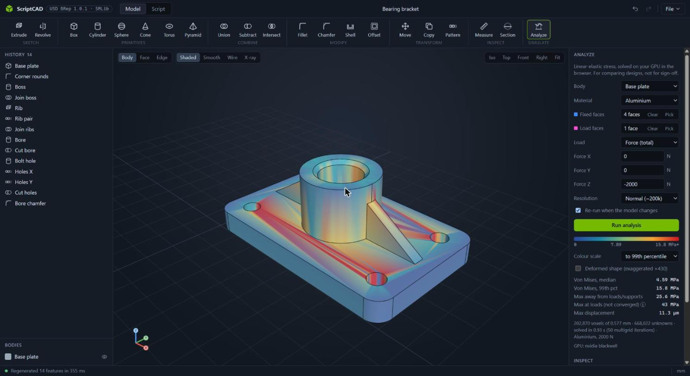

**Simulate → Analyze** runs a linear-elastic stress analysis of a body and colours it by
von Mises stress. The solve happens on your GPU through WebGPU, so it needs a recent
Chrome or Edge, and the simulation extra on the server:

```bash
uvx --python 3.12 --from "scriptcad[sim] @ git+https://github.com/rubenhekkens/scriptcad" scriptcad
```

1. Press **Pick** next to *Fixed faces* and click the faces that are held (bolt holes,
   a clamped face). Then pick *Load faces*.
2. Choose a load: a total **force** (N), a **pressure** (MPa) or a **torque** (N·m about an
   axis through the load faces), a material and a resolution.
3. **Run analysis.** With *Re-run when the model changes* on, every edit to the feature
   history re-runs it, so you can change a dimension and watch the stress follow.

The example bracket (four bolt holes held, 2 kN down on the bore, ~670k unknowns) solves
in about 1 s on an RTX 5070 and 1.5 s on Intel integrated graphics.

Voxels on the surface are as stiff as they are full (measured with rays along x, y and z),
not all or nothing, so results change smoothly as a face moves by less than a voxel. With
all-or-nothing voxels, four alike 1 mm steps of the slab (Rebalance, below) came out at −19%,
−3.7%, −15% and 0% deflection, depending on how the faces fell on the grid; now they come out
at −12%, −9.4%, −9.8% and −7.4%, close to beam theory.

### Example: less material, more stiffness

**File → Load bridge example** opens three 200 mm steel bridges, each clamped at both ends
with 2 kN spread over its deck, and runs all three. Supports and loads are set per body;
material, load and resolution are shared, so the comparison is fair, and every body uses
the same colour scale and the same deformation scale.

| Design | Mass | Deflection | Stress (99th pct) | Stiffness per gram |
|---|---:|---:|---:|---:|
| A · Solid slab | 502 g | 32.6 µm | 29.8 MPa | 1× |
| B · I-girder | 349 g (−31%) | **10.5 µm** | **15.4 MPa** | **4.5×** |
| C · Truss | 333 g (−34%) | 19.2 µm | 24.1 MPa | 2.6× |

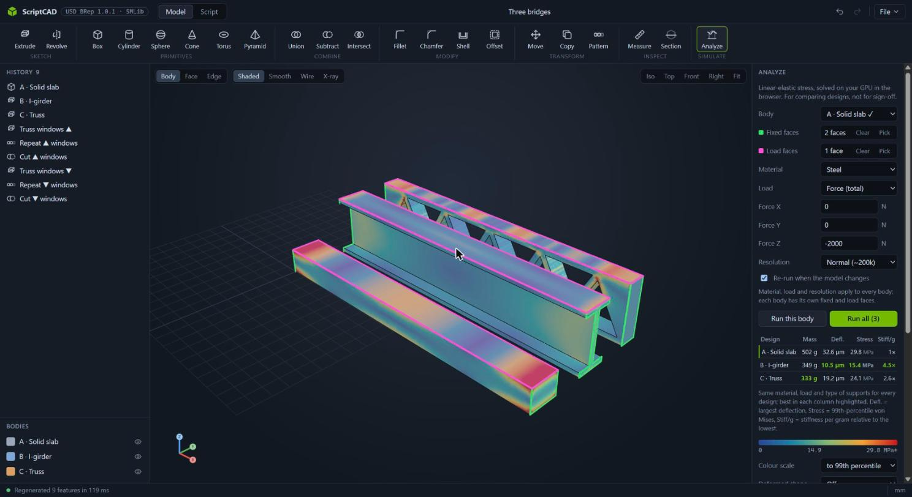
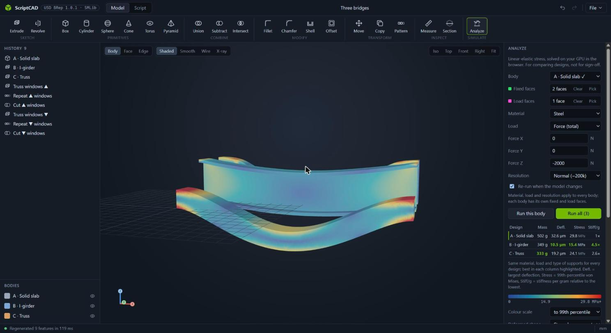

Material placed far from the middle of the section does the work: the girder's
flanges give it 7.5× the slab's bending stiffness with less steel. Its deflection is
higher than bending theory alone (3.9 µm) because the thin web also shears, which adds
~6 µm and matches the textbook shear term. The truss is stiffer than the slab too, but its
sharp joints concentrate stress (55.6 MPa peak away from the supports, against the slab's
35.7 MPa), which is why real trusses use gusset plates.

**Show → Underused material** makes the reason visible. It shades the material that
carries less than a fifth of the design's own 99th-percentile stress, and the *Idle* column
gives that share of the volume: **40%** of the slab (about 200 g of steel), 24% of the truss,
13% of the girder. Seen from the front, the slab's idle material is a band along the middle
of its height, splitting toward the quarter points where the bending moment changes sign.
That band is exactly the material the girder leaves out.

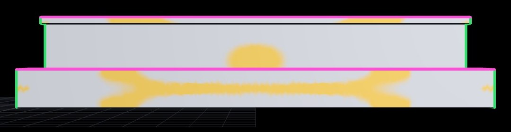

How to read it:

- **The colour scale stops at the 99th percentile** by default. Next to supports and
  load faces the peak stress is singular: it keeps rising as the voxels get finer, so the
  panel shows it as "not converged" and reports the maximum *away* from them separately.
- It is for **comparing designs**, not sign-off: linear elastic, small deflections, no
  contact, faces fully fixed, typical material values. See `bench/fea/README.md` for the
  measured accuracy (a few percent on closed-form benchmarks).
- On a laptop with two GPUs, browsers often get the integrated one. The panel says which
  GPU it is using; set your browser to *High performance* in Windows Settings › System ›
  Display › Graphics and fully restart it for several times faster results.

### Explore: let it find a lighter design

*Explore variants*, at the bottom of the Analyze panel, solves many versions of a body
and plots mass against deflection. Tick the variables to vary and give each a range;
optionally set a maximum deflection and a maximum stress. ScriptCAD spreads the variants
evenly over the ranges, rebuilds and solves each one exactly like a normal analysis, and
marks the ones that meet the limits. A line joins the best trade-offs: the variants that
no other variant beats on both mass and deflection. Click a dot, or **Use it** on the
suggestion, and its values go into your variables. The result is your own feature tree
with new numbers in it, not a mesh to redraw.

In the bridge example the girder is drawn from four variables (the slab and truss have their own, see Pull below): flange width `bf`, flange
thickness `tf`, web thickness `tw` and depth `H`. Varying the first three over ±50%
with a 15 µm deflection limit takes 25 solves (about 2.5 minutes on integrated graphics):

| I-girder | bf | tf | tw | Mass | Deflection | Stress (99th pct) | Stiffness per gram |
|---|---:|---:|---:|---:|---:|---:|---:|
| As drawn | 20 | 3 | 3 | 349 g | 10.5 µm | 15.4 MPa | 4.5× |
| Lightest under 15 µm | 10.1 | 3.3 | 1.9 | **204 g (−41%)** | 14.9 µm | 23.9 MPa | **5.4×** |

Narrow, thick flanges on a thin web: the steel goes to the top and bottom of the
section, where it carries the most bending load. The girder as drawn (the ring) is not on
the line at all: some variants are both lighter and stiffer. Limits use the
99th-percentile stress, never the peak, which grows without bound next to supports and
loads.

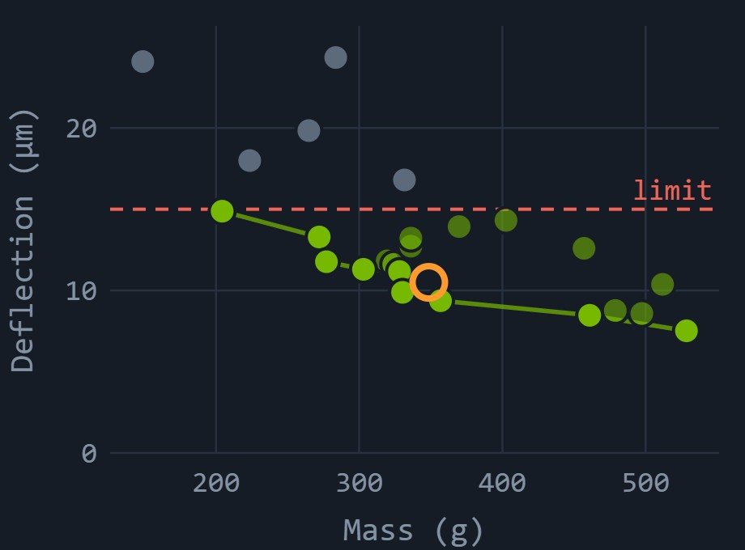

### Remove unused material: let the load decide the shape

Explore changes numbers in your design. *Remove unused material*, below it, needs no
design at all. It keeps the body's outer dimensions and carves the inside voxel by voxel:
solve, drop the voxels that store the least strain energy, solve again. Each step removes
3% of the material until you reach the share you chose (5–70%), or, with a *Max deflection*,
until the next step would deflect more than that. Scores are smoothed over the *Smallest
member* size, so the shape doesn't break up into a checkerboard, and voids next to busy
material can fill back in. Material at supports and loads always stays, and any piece that
loses its connection to a support is removed. This is BESO (bi-directional evolutionary
structural optimisation). It runs in the browser on the GPU solver. After every step the
viewport shows the shape as a smoothed surface, coloured by how hard the material works,
with the original body as a ghost. *Surface → Voxels* shows the design as solved.

Carving the solid slab down to half its steel takes 32 solves (72 s on integrated
graphics). Cut through the middle of its width, the result is a truss: a top chord over
the whole span, a bottom chord across the middle, and diagonal struts carrying the load
out to the clamped ends.

| Solid slab | Mass | Deflection | Stiffness per gram |
|---|---:|---:|---:|
| Original | 502 g | 32.6 µm | 1× |
| Carved to 50% | 251 g | 45.6 µm | **1.4×** |

A slab half as deep, the obvious way to halve the steel, would have an eighth of the
bending stiffness.
The result is a voxel mesh (**Download STL**), not editable features: use it to redraw the
part, or print it.

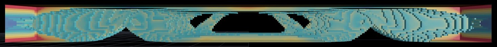

**How accurate is it?** On the standard MBB beam, Carve's designs are within 1–2% of the
stiffness of a SIMP reference (the method of the classic 88-line code), as long as the
smallest member spans at least about 3 voxels. Below that they fall well short. The layout
of the slab is the same at Normal and Fine resolution. Carve maximises stiffness for one
load case: it doesn't check strength or buckling, and a design tuned for one load can do
worse under another. See [bench/topo](bench/topo/README.md).

### More carving examples (File menu)

| Example | Set-up | Result |
|---|---|---|
| **Bone-inspired chair** | the chair from the video: a block with rounded corners, two front feet close together and one rear foot, the seat and back loaded, leaning back (aluminium, 18%, medium members, fine resolution) | webbed, bone-like side frames; see [Carve](#carve-the-stiffest-shape-for-its-weight) |
| **Lounge chair** | a long, low block with three feet, seat and reclined back as the loaded faces (aluminium, 8%) | struts fan out of the rear foot into seat and back, slim front legs |
| **Chaise longue** | a 160 cm curved lying surface on four feet (ABS, 10%); a body-weight load distribution is in `bench/topo/chaise_carve.js` | a branching tree grows from each foot |
| **B1 pile table** | the platform that lifts a pallet with a B1 paper pile into a press feeder, on four chain lugs (steel) | at equal mass 1.5× stiffer than a welded tube frame; see [PALLET.md](bench/topo/PALLET.md) |

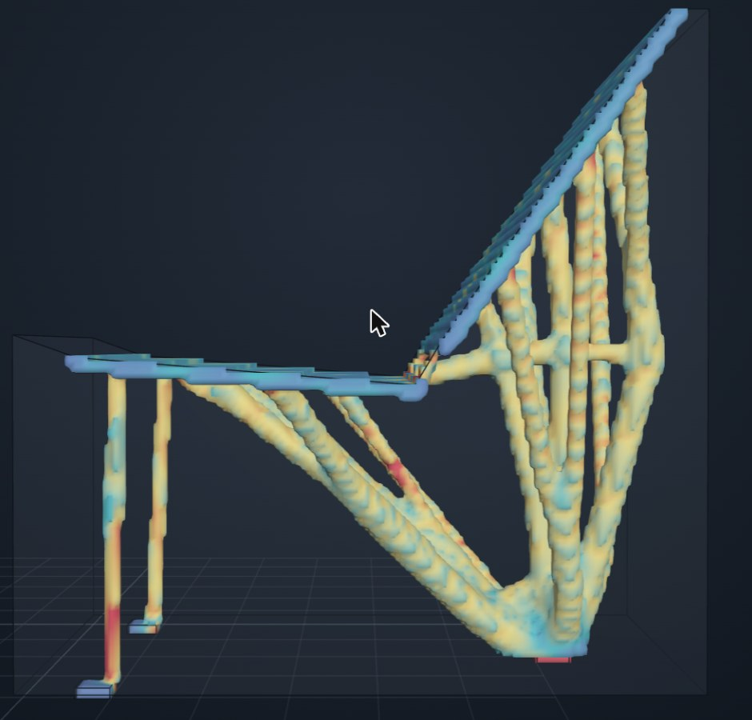
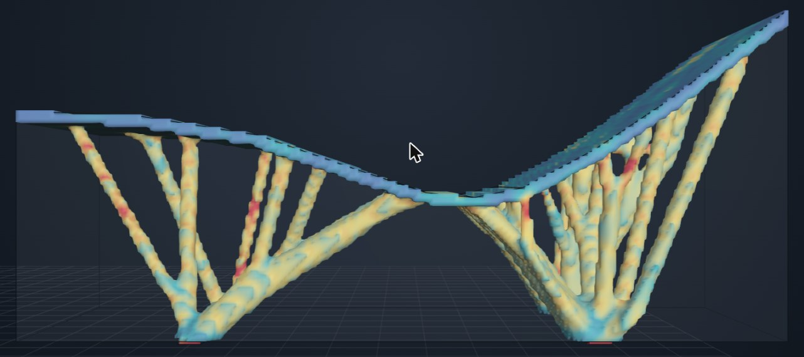
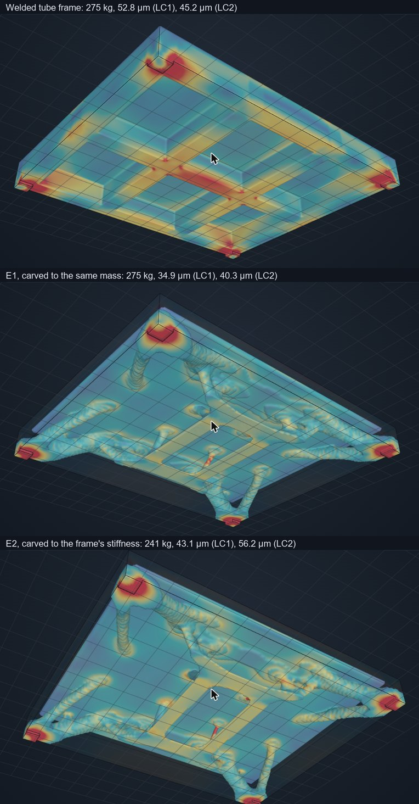

### Push to load, and VR

**Push**, in the Analyze panel, turns the mouse into a load. Press and hold on an analysed
part: the force grows to *Max force* in 1.5 s, pushing into the surface over a palm-sized
patch. The part bends (exaggerated) and its stress colours follow your press. Let go and it
springs back to its own load case. It reuses the last analysis's voxel model and only swaps
the forces. Since the response is linear and a press stays at one point, the GPU solves
once per axis the press uses, for a unit force; after that every update is a weighted sum of
those solutions, and only the stresses are recomputed. At Normal resolution on the slab, the
first update takes 0.6 s on an RTX 5070 and 2.2 s on a Quest 3S. After that, updates take about
150 ms on both. On the
bridges, 2 kN pressed at mid-span bends the slab 64.7 µm, against 32.6 µm for the same load
spread over its deck: the 2× that beam theory gives a clamped beam.

**Pull**, in the same section, shapes the part by dragging a face. On grab, ScriptCAD nudges
each numeric variable once and rebuilds the model. The variable that moves the grabbed point
furthest along the face's normal drives the face. Your drag then sets that variable, in
round steps of about 5% of its value. Each step is rebuilt at once and shown in grey, then
solved in the background and coloured on the colour scale the design had when grabbed. The
panel compares mass, deflection and stress with the starting design: pulling the I-girder's
top face from H = 40 to 56 mm gives +15% mass, −44% deflection and −29% stress. The slab
(`slabT`, `slabW`) and the truss (height `trussH`, thickness `trussT`, chord thickness
`chord`; its windows follow) have variables too. Pulling the truss's top up 10 mm gives only
−5% deflection for +14% mass, while one more millimetre of chord, pulled from inside a window,
gives −13% for +8%: the thin chords bending between the nodes limit it, not its depth. Every
variant is solved at the voxel size of the design as grabbed; otherwise that size follows
the part's volume, and its own few-percent effect on thin members can hide the design's. Support and
load points on a moved face move with it. Let go to keep the value, as one undo step. The
solve made during the drag is reused, so nothing is solved twice. On Intel integrated
graphics a girder step takes about 5 s: 1 s to build the voxel model on the server, 2.5 s
to solve (starting from the previous step's answer), 0.6 s for the stresses; the slab takes
about 2 s. A face that no variable drives can't be pulled; give its size a variable first.

**Where to pull.** With Pull on, an arrow per variable shows what one step of it does,
worked out from the current results without solving again (a few seconds for all three
bridges): green where adding material buys the most stiffness per gram, orange where it buys
the least, so that material is the cheapest to trim. The panel lists each variable's change
in deflection and mass per step. Behind it is the shape derivative of compliance: material
added where the strain energy density σ:ε is high stiffens a part most. Each variable is
nudged once and rebuilt, the server compares the new shape with the solved one voxel by
voxel, and sums σ:ε over the material added and removed (plus a term for a loaded face that
moves its load along; near supports and loads, where σ:ε grows without bound as the voxels
shrink, it is capped). Against solving the changed shape:

| Change | Solved | Predicted |
|---|---|---|
| Slab thickness 16 → 17 | −15.8% | −15.7% |
| Girder depth H 40 → 42 | −7.0% | −7.8% |

The truss's 3 mm members are five voxels across at Normal, too few for its small changes
to be solved reliably either way.

**Rebalance** (in the hints) moves material from orange to green: per round, one step more of
the best variable and as many steps less of the worst as keep the mass level, solved, and
kept only if the part got stiffer. On the slab it trades width for depth (16 × 20 to 21 × 15
mm in five rounds, each 6-12% stiffer at the same mass); on the girder, flange width for
depth. It only knows the load case it is given: a narrow, deep beam is stiffer under this load
but buckles sideways more easily, which the analysis does not model.

**Tap to hear it** (below Push): click a part and you hear its first four natural frequencies
at their real pitch, each as loud as the tapped spot moves in it, and see the loudest one
swing, slowed down. The first tap on a part works them out (on a Draft voxel model, by
subspace iteration with the static multigrid solver; about 17 s on integrated graphics), and
they are kept until the part changes. The slab rings at 2.07 kHz (vertical bending; beam
theory, which ignores shear, gives 2.13 kHz) and 2.52 kHz (sideways; 2.66 kHz).

**Voice** (at the bottom of the panel): hold *Hold to talk* and say a command: "set H to 50",
"make the slab T 18 mm", "increase chord by one", "truss H plus 4", "rebalance", "push",
"pull", "tap", "undo", "redo", "stop". Variable names are matched however Whisper spells
them ("slab T", "slabT"), and numbers may be digits or words. A change is one undo step, and
support and load points move with their faces.

Whisper runs on the computer the server runs on, through
[faster-whisper](https://github.com/SYSTRAN/faster-whisper); the recording never leaves it.
faster-whisper may be installed in another Python than ScriptCAD's: the server runs it as a
helper process with whichever interpreter has it (`SCRIPTCAD_WHISPER_PYTHON` names one,
otherwise it checks its own and those the Windows `py` launcher lists). It uses the model
`SCRIPTCAD_WHISPER_MODEL`, else the best English one already in the Hugging Face cache
(`small.en`, then `base.en`), and never downloads one. It runs on an NVIDIA GPU if
faster-whisper's Python has CUDA's cuBLAS (`pip install nvidia-cublas-cu12`; the helper adds
its DLL folder to the search path), else on the CPU. The model loads when VR starts or at
the first press of the button (10-25 s); then a command with `small.en` takes about 0.2 s on
an RTX 5070, 2.7 s on the CPU (`base.en` on the CPU: 0.9 s, but it mishears more). The variable
names are passed to Whisper as a prompt, so "set H to fifty" comes back as `Set H to 50`.

**VR** (the button next to *Fit*) opens the model in a WebXR headset, such as a Quest's
browser or Chrome with a PC headset. Parts under 60 cm stand on a table at hand height,
enlarged to about 80 cm (the label gives the factor); larger ones stand on the floor at full
size. Tracked hands are drawn as balls on their joints. A switch in front of the table
picks what a pinch (or trigger) on the part does, and the ray and the cursor on the part
take its colour:

- **PUSH** (yellow, an arrow into the surface): pushes straight into the surface, with the
  force building up over 1.2 s to the trigger's depth. Each new spot needs one solve first
  (about 1.5 s on a Quest 3S). Meanwhile a ring at the spot fills and counts down the
  seconds left, then pops as the part starts to bend. A floating label shows force,
  deflection and stress. Run the analysis first.
- **PULL** (blue, an arrow out and in): pinch a face and move your hand; the hand's travel
  along the face's normal is the drag (see Pull above), at least 2 cm of it per step, and
  a step changes only well past its middle, so a shaky hand stays on one. A step is solved
  once the hand has rested on it for 0.6 s; a solve the hand moves away from is stopped,
  and letting go finishes the step you kept, so its stress shows. The old shape stays as an
  outline, and the panel above the part shows the value before and after, with mass,
  deflection and stress as bars, green where the change helps and orange where it hurts.
  The arrows of *Where to pull* show which faces are worth pulling.
- **TAP** (purple): pinch the part to hear it ring and see it swing, as on the desktop.
- **AUTO** runs Rebalance on every part; pinch it again to stop. The panel above the part
  reports each round.
- **VOICE**: pinch and hold, say a command, let go. The Quest records it, Whisper on the PC
  writes it down, and the panel above the part shows what was heard and done. "push", "pull"
  and "tap" switch the mode.

A pinch beside the part, or a controller's grip button, picks the model up. The button is
greyed out when no headset is found.

On a Quest, `localhost` is the headset itself, and browsers only allow WebXR on `localhost`
or HTTPS. Connect the Quest by USB with developer mode on, and forward the port:

```
adb reverse tcp:8765 tcp:8765
```

Then `http://localhost:8765` in the Quest browser reaches ScriptCAD on your PC. Don't serve
ScriptCAD on your network instead: it runs the scripts it's sent.

## How it works

- `src/scriptcad/kernel.py` holds all the `usd_brep` calls. Each feature compiles to
  a Python snippet. Regeneration runs the snippets in order, then tessellates
  the bodies that remain, producing per-triangle face IDs, exact BRep edge
  polylines and mass properties. Edge and face picks are stored as 3D points
  and re-resolved with `find_edge`/`find_face`, so a reference still works
  after upstream edits as long as that geometry still exists.
- `src/scriptcad/server.py` is a FastAPI server. Kernel work runs in a separate
  worker process, which is restarted if it crashes or times out.
- `src/scriptcad/web/` holds the three.js viewport and the UI. There is no
  build step. three.js 0.169.0 and CodeMirror 5.65.16 are vendored in
  `web/vendor/` (both MIT, license files included), so the app works offline.

Scripts run as ordinary Python on your machine, so only run scripts you trust.
The server listens only on 127.0.0.1.

## License

Apache-2.0. See [LICENSE](LICENSE).
