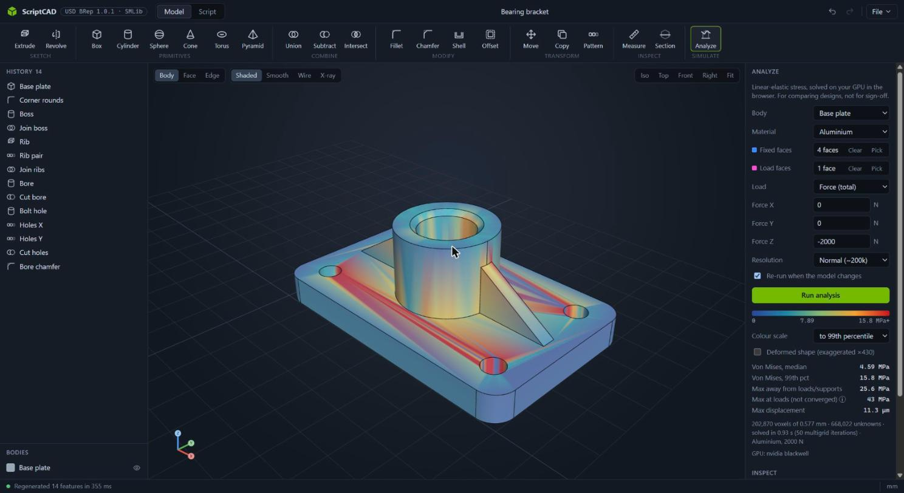
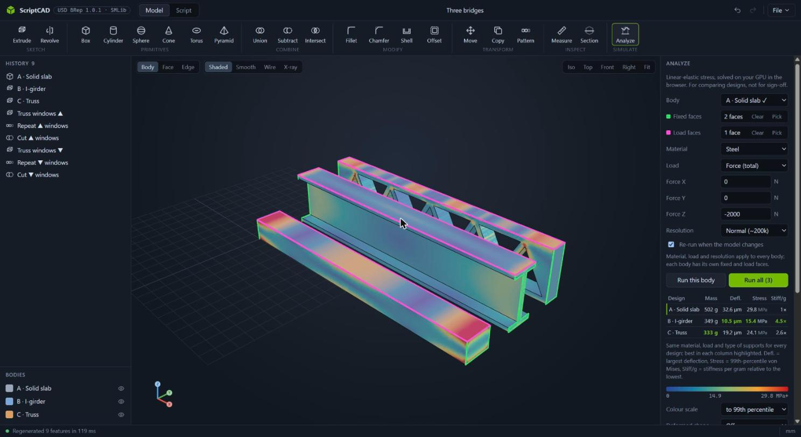
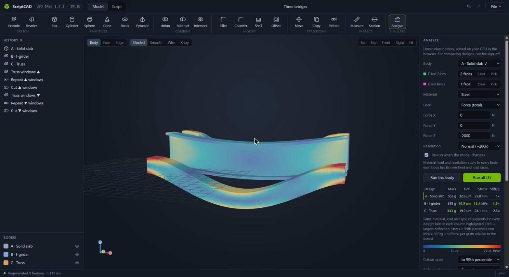
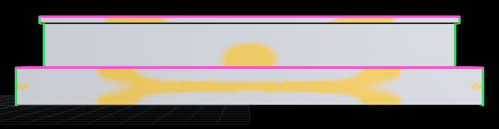

# ScriptCAD

A browser-based CAD interface on top of NVIDIA's open-source **USD BRep** kernel
(`usd-brep`, the SMLib NURBS solid modeler, Apache-2.0, released October 2026).

There are two ways to model, and both use the same viewport:

- **Model** is a parametric feature history: primitives, sketch extrude/revolve,
  booleans, fillet/chamfer on picked edges, shell with picked faces, offset,
  move/copy, linear and circular patterns, and STEP and USD BRep import. When you edit a
  feature, everything after it regenerates.
- **Script** is plain Python against the kernel (`sm` = `usd_brep`, `show(brep)`
  to display), with `sm.` autocompletion. **From history** turns the feature
  tree into the equivalent script. That works because the history is compiled
  to exactly that code.

Exports: STEP (AP214), exact BRep as OpenUSD (`.usda` / `.usdc`, `BrepArray` prims),
tessellated `UsdGeomMesh`, and STL.

## Install and run

ScriptCAD runs on **Windows (x86_64) and Linux (x86_64, aarch64)** with CPython
3.12, because those are the only builds of `usd-brep`. **macOS isn't supported.**

With [uv](https://docs.astral.sh/uv/) you don't need a Python 3.12 install first,
because uv fetches one:

```bash
uvx --python 3.12 scriptcad
```

Or with pip in a Python 3.12 environment:

```bash
pip install scriptcad
scriptcad
```

The browser opens at http://127.0.0.1:8765. Options: `--port 9000`, `--no-browser`.
To change the per-request kernel timeout (default 90 s), set `SCRIPTCAD_TIMEOUT`.
Imported USD files are copied to a per-user data folder: `%LOCALAPPDATA%\scriptcad\uploads`
on Windows, `~/.local/share/scriptcad/uploads` on Linux.

### STEP import and export

STEP support is optional. It needs OpenCASCADE, which ships as a separate wheel:

```bash
uvx --python 3.12 "scriptcad[step]"      # or: pip install "scriptcad[step]"
```

Then use **File → Import STEP or USD BRep…** (`Ctrl+I`) and **File → Export STEP**.
Each solid in a STEP file becomes an editable body.

How it works:

- **Import:** OpenCASCADE reads the STEP file. NVIDIA's `occt_to_usd`
  converter then turns each solid into the kernel's USD BRep format.
- **Export:** ScriptCAD's own exporter (`occt_bridge.py`) rebuilds each body from
  the kernel's exact curves and surfaces in OpenCASCADE and writes AP214 STEP.

NVIDIA's converter isn't in the `usd-brep` wheel. On first STEP import,
ScriptCAD downloads a prebuilt copy for Windows x86_64 or Linux x86_64, about
46 MB. It's Julia's [BinaryBuilder](https://github.com/JuliaPackaging/Yggdrasil)
build of NVIDIA's usd-brep v1.0.0 source, plus its OpenUSD, oneTBB and C++
runtime libraries. ScriptCAD pins every download by sha256 and unpacks it into
the per-user data folder. To download ahead of time, run
`scriptcad --install-step-tools`. To use your own build of usd-brep's tools
instead, set `SCRIPTCAD_OCCT_TOOLS` to the folder containing `occt_to_usd`.

Known limits of the v1.0.0 converter:

- Some analytic faces fail to translate, for example the apex of a pointed cone.
  ScriptCAD retries those parts with every surface converted to NURBS and warns
  when it does. The geometry stays exact, but faces lose their analytic type.
- NVIDIA reports planar faces bounded by rational B-spline edges importing about
  0.65% too large ([usd-brep#11](https://github.com/NVIDIA-Omniverse/usd-brep/issues/11)).

### From source

```bash
git clone <this repo>
cd scriptcad
uv sync          # creates .venv with Python 3.12 and the dev tools
uv run scriptcad
uv run pytest
```

## Using it

| | |
|---|---|
| Orbit / pan / zoom | left drag / right or middle drag / wheel |
| Selection filter | `1` body, `2` face, `3` edge (Shift/Ctrl-click to add) |
| Fit view | `F` |
| Measure | `M`, then click two points |
| Confirm / cancel a feature | `Enter` / `Esc` |
| Undo / redo | `Ctrl+Z` / `Ctrl+Y` |
| Save / open project (`.scad.json`) | `Ctrl+S` / `Ctrl+O` |
| Run script | `Ctrl+Enter` |

To pre-fill a feature, select edges before you press **Fillet** or **Chamfer**,
or select two bodies before you press a **Combine** tool. While you pick edges
or faces for a feature, the model rolls back to the state just before that
feature.

## Analyze: stress on your GPU, in the browser



**Simulate → Analyze** runs a linear-elastic stress analysis of a body and colours it by
von Mises stress. The solve happens on your GPU through WebGPU, so it needs a recent
Chrome or Edge, and the simulation extra on the server:

```bash
uvx --python 3.12 "scriptcad[sim]"        # or: pip install "scriptcad[sim]"
```

1. Press **Pick** next to *Fixed faces* and click the faces that are held (bolt holes,
   a clamped face). Then pick *Load faces*.
2. Choose a load: a total **force** (N), a **pressure** (MPa) or a **torque** (N·m about an
   axis through the load faces), a material and a resolution.
3. **Run analysis.** With *Re-run when the model changes* on, every edit to the feature
   history re-runs it, so you can change a dimension and watch the stress follow.

The example bracket (four bolt holes held, 2 kN down on the bore, ~670k unknowns) solves
in about 1 s on an RTX 5070 and 1.5 s on Intel integrated graphics.

### Example: less material, more stiffness

**File → Load bridge example** opens three 200 mm steel bridges, each clamped at both ends
with 2 kN spread over its deck, and runs all three. Supports and loads are set per body;
material, load and resolution are shared, so the comparison is fair, and every body uses
the same colour scale and the same deformation scale.

| Design | Mass | Deflection | Stress (99th pct) | Stiffness per gram |
|---|---:|---:|---:|---:|
| A · Solid slab | 502 g | 32.6 µm | 29.8 MPa | 1× |
| B · I-girder | 349 g (−31%) | **10.5 µm** | **15.4 MPa** | **4.5×** |
| C · Truss | 333 g (−34%) | 19.2 µm | 24.1 MPa | 2.6× |




Material placed far from the middle of the section does the work: the girder's
flanges give it 7.5× the slab's bending stiffness with less steel. Its deflection is
higher than bending theory alone (3.9 µm) because the thin web also shears, which adds
~6 µm and matches the textbook shear term. The truss is stiffer than the slab too, but its
sharp joints concentrate stress (55.6 MPa peak away from the supports, against the slab's
35.7 MPa), which is why real trusses use gusset plates.

**Show → Underused material** makes the reason visible. It shades the material that
carries less than a fifth of the design's own 99th-percentile stress, and the *Idle* column
gives that share of the volume: **40%** of the slab (about 200 g of steel), 24% of the truss,
13% of the girder. Seen from the front, the slab's idle material is a band along the middle
of its height, splitting toward the quarter points where the bending moment changes sign.
That band is exactly the material the girder leaves out.



How to read it:

- **The colour scale stops at the 99th percentile** by default. Next to supports and
  load faces the peak stress is singular: it keeps rising as the voxels get finer, so the
  panel shows it as "not converged" and reports the maximum *away* from them separately.
- It is for **comparing designs**, not sign-off: linear elastic, small deflections, no
  contact, faces fully fixed, typical material values. See `bench/fea/README.md` for the
  measured accuracy (a few percent on closed-form benchmarks).
- On a laptop with two GPUs, browsers often get the integrated one. The panel says which
  GPU it is using; set your browser to *High performance* in Windows Settings › System ›
  Display › Graphics and fully restart it for several times faster results.

## How it works

- `src/scriptcad/kernel.py` holds all the `usd_brep` calls. Each feature compiles to
  a Python snippet. Regeneration runs the snippets in order, then tessellates
  the bodies that remain, producing per-triangle face IDs, exact BRep edge
  polylines and mass properties. Edge and face picks are stored as 3D points
  and re-resolved with `find_edge`/`find_face`, so a reference still works
  after upstream edits as long as that geometry still exists.
- `src/scriptcad/server.py` is a FastAPI server. Kernel work runs in a separate
  worker process, which is restarted if it crashes or times out.
- `src/scriptcad/web/` holds the three.js viewport and the UI. There is no
  build step. three.js 0.169.0 and CodeMirror 5.65.16 are vendored in
  `web/vendor/` (both MIT, license files included), so the app works offline.

Scripts run as ordinary Python on your machine, so only run scripts you trust.
The server listens only on 127.0.0.1.

## License

Apache-2.0. See [LICENSE](LICENSE).
