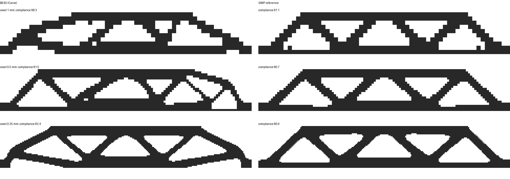
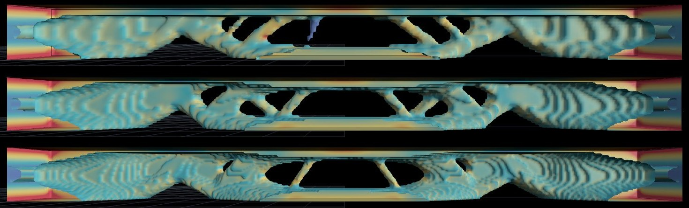

# How good is Carve? Topology-optimisation benchmark

*Remove unused material* (Carve) runs hard-kill BESO in the browser (`src/scriptcad/web/fea/topo.js`).
This folder checks it against a reference method and across resolutions, and holds two
applied studies.

| File | What |
|---|---|
| `benchmark.py` | MBB beam: our BESO against a SIMP reference, at three voxel sizes |
| `run_beso.mjs` | runs the app's optimiser in Node, with every solve done by Python (float64 PyAMG) |
| `pallet_experiment.js`, `PALLET.md` | B1 pile table: welded frame against carved designs (in-browser, GPU) |
| `chaise_carve.js` | chaise longue carved under a body-weight load distribution (in-browser, GPU) |
| `results/` | numbers (`results.json`, `pallet_results.json`), designs (`designs_*.npz`), pictures |

## 1. Optimality: MBB beam against SIMP

The MBB beam is the standard test case: 60 × 10 mm, 1 mm thick, pinned on a 1 mm patch at the
bottom left, on a roller at the bottom right, with 1 N spread over 2 mm at the middle of the top.
The target is 50% of the material. Supports and load act on patches of fixed size, so compliance
converges as the grid is refined (point loads would make it diverge). The smoothing radius is
fixed at 1.5 mm.

* **BESO:** the app's own optimiser, unchanged (`run_beso.mjs`).
* **SIMP:** the reference method, written independently in `benchmark.py`: penalised densities
  (p = 3), a density filter and optimality-criteria updates, the algorithm of the 88-line code
  by Andreassen et al. (2011). It runs on the same voxels and element, with the same material
  kept solid at supports and loads, and is thresholded to the same 50% of solid voxels.
* **Scoring:** both final designs are scored by the same float64 solve. Compliance is f·u, so
  lower is stiffer.

| Voxel size | Smoothing radius | Solid beam | BESO (Carve) | SIMP | BESO vs SIMP |
|---|---:|---:|---:|---:|---:|
| 1 mm (60 × 10) | 1.5 voxels | 52.8 | 98.3 | 81.1 | **+21%** |
| 0.5 mm (120 × 20) | 3 voxels | 53.3 | 81.5 | 80.7 | **+1.0%** |
| 0.25 mm (240 × 40) | 6 voxels | 53.7 | 82.4 | 80.6 | **+2.2%** |

* **Carve is within 1–2% of the reference** once the smoothing radius spans at least about 3
  voxels. At 1.5 voxels it is 21% worse; SIMP's result hardly changes there (81.1), so the
  shortfall is ours. In the app, "Fine" members are 2.5 voxels at Normal resolution, at the edge
  of that range, so Medium is the safer default.
* **Layouts differ even when stiffness agrees.** 23–26% of the voxels differ between the two
  designs: the optimum is flat, and several layouts are nearly equally stiff.
* **Carve's layouts are not symmetric** although the problem is (see the 0.5 and 0.25 mm rows).
  Hard-kill removal of whole voxels in ranked order breaks ties unevenly. SIMP's continuous
  densities stay symmetric.
* SIMP converged in 48 and 151 iterations at 1 and 0.5 mm and hit the 200-iteration cap at
  0.25 mm. Its compliance had already settled (80.7 → 80.6).

## 2. Resolution: the bridge slab in the app

The bridge example's solid slab, carved to 50% with Medium members (a fixed physical size since
this study) at the app's three resolutions:

| Resolution | Solid slab | Carved to 50% | Carved ÷ solid |
|---|---:|---:|---:|
| Draft | 28.7 µm | 46.0 µm | 1.60 |
| Normal | 32.6 µm | 46.9 µm | 1.44 |
| Fine | 30.5 µm | 43.9 µm | 1.44 |

* **The layout is stable:** normal and fine give the same truss (top chord, central opening,
  diagonals, arches over the quarter points). Draft is a little asymmetric.
* **The carved deflection varies by only ±3.5%.**
* **The solid baseline does not converge smoothly** (28.7, 32.6, 30.5). That probably comes from
  how the support and load faces map onto voxels, and it moves the "stiffness per gram" ratio by
  up to about 10%.
* The results are identical on an Intel integrated GPU and an RTX 5070. On the RTX, a carve at
  Normal resolution takes 25 s, against 85 s on the integrated GPU.

Thicker members cost a little stiffness: at Normal resolution, Fine / Medium / Coarse members give
45.7 / 46.9 / 48.8 µm.

## Fixes this study led to

* **Member size was a voxel count**, so draft, normal and fine carved different designs. It is
  now a physical size, in mm, for the body.
* **Carving stalled in a background tab.** After each step it waited for a screen frame, and
  hidden tabs get none.
* **A target below what supports and loads must keep stopped Carve with an error.** It now
  raises the target and says so.

## What is still not checked

* **Strength:** stress is not limited, and thin members and the carved brackets at supports
  need a stress check.
* **Buckling** of slender compression members.
* **More than one load case.** `PALLET.md` shows a design tuned for one load can be 24% worse
  than a conventional frame under another.
* **The smoothed surface:** mass and deflection are of the voxel design. The smoothed STL keeps
  the volume within 5% but its stiffness is not re-solved.

usage: `python bench/topo/benchmark.py` (about 45 minutes, mostly SIMP at 0.25 mm), or
`--draw` to redraw `results/layouts.png` from the saved designs.
