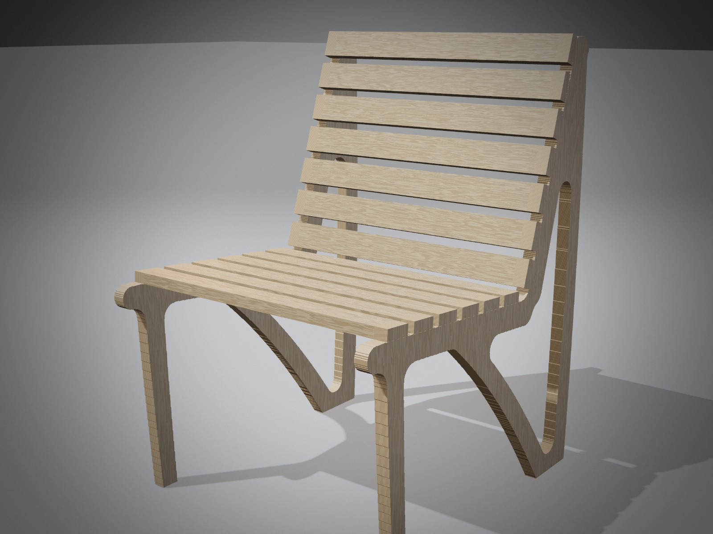
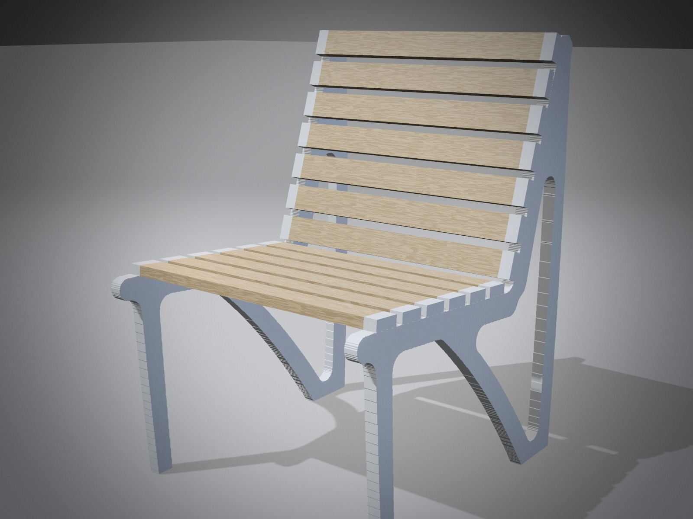
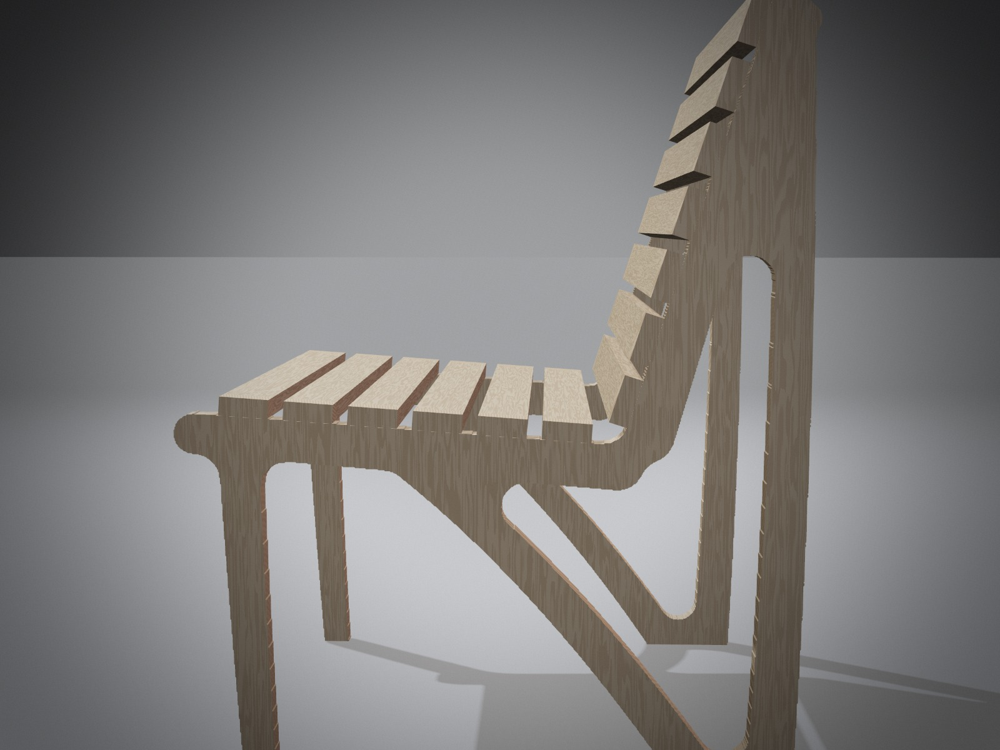

# Wooden lounge chair, after Santiago Calatrava

**Idea.** Calatrava's structures show how they carry their load: a sweeping spine, tapered members
that meet in long curves, and a rhythm of ribs (his bridges, the Milwaukee Art Museum's brise-soleil,
the Oculus). This chair does the same in wood. Each side frame is a single flat sheet whose shape
follows the load paths of a sitting person, with a diagonal spine sweeping from under the seat to the
rear foot. The seat and back are a row of ash slats, like ribs. It can be cut on any CNC router
and assembled with dowels and glue.

| | |
|---|---|
| Size | 560 wide × 692 deep × 836 high (mm); seat 405 at the front, sloping to 375; back reclined about 18° |
| Weight | about 9.4 kg (frames 3.8 kg, slats 5.6 kg) |
| Material | birch plywood 24 mm (frames), ash 22 × 52 mm (slats) |

## How it was designed (in ScriptCAD)

1. **Carve found the structure.** The chair's side profile, as a plywood plate on a front and a rear
   foot, was carved by ScriptCAD's Carve tool under half the load of a seated person (0.8 kN on the
   seat edge, 0.25 kN pushing on the back edge). It kept 32% of the plate:
   - a front leg;
   - the seat rail;
   - a diagonal from under the seat to the rear foot;
   - the back rail and a rear post, triangulated.

   (`side_frame.py`, `frame_profile.png`.)
2. **The result was redrawn for wood.** A topology result isn't something you machine as is. The frame was redrawn as tapered
   members along those load paths, joined with 26 mm radii. The seat and back lines stay straight
   for the slats, and the feet stand flat. (`chair.py`, `frame.png`.)
3. **Checked, then slimmed.** The first version (36 mm, wider members) was 15–40× stronger than needed. The frame went down to one
   24 mm sheet with slimmer members. The analysis then showed the seat-back corner as the weak spot
   when leaning back. Wider rails into that corner and a 25 mm inside radius brought the peak stress there
   from 15 to 11 MPa.

## Strength (ScriptCAD Analyze, whole chair, birch plywood E = 9 GPa; run with 20 mm slats, the 22 mm slats only stiffen it)

| Load case | Stress in the members | Peak (at a junction) | Deflection | Margin over the design strength |
|---|---:|---:|---:|---:|
| Seated person: 1.6 kN on the seat, 0.5 kN on the back | 1.6 MPa | 4.0 MPa | 0.5 mm | 6.8× |
| Hard lean back: 0.6 kN on the top of the back | 2.7 MPa | 11.4 MPa | 2.2 mm | 2.4× |
| Sideways push: 0.3 kN across the seat, seat loaded 1.0 kN | 2.8 MPa | 7.6 MPa | 1.2 mm | 3.5× |

- **Design strength:** birch plywood in bending, 27 MPa (40 MPa characteristic, × 0.8 for long-term
  load, / 1.2 for the material). The margins are on top of that.
- **Resolution check:** the seated case was also solved at a finer resolution; the member stress is
  the same (1.8 MPa in both).
- **A single slat** spans 512 mm between the frames. Under 1 kN on one slat (someone kneeling on it), a
  20 mm slat reaches about 37 MPa, against about 50 MPa design strength for ash. That's fine, but it's the
  thinnest margin in the chair, so the slats are 22 mm (about 20% stronger, about 31 MPa).
- **Not modelled:**
  - the joints themselves (the model joins the slats to the frames solidly; the dowels and glue below must do that);
  - plywood's different stiffness along and across the face grain;
  - long-term creep.

  A prototype tested to EN 1728 / EN 12520 (furniture strength, seating) is the step before a series.

## Making it

| Part | Material | Size (mm) | Qty | Notes |
|---|---|---|---|---|
| Side frame | birch plywood 24 mm, BB/BB | `side_frame_x2.dxf`, about 700 × 830 | 2 | face grain vertical, along the rear post; round all edges r = 5 |
| Seat slat | ash | 22 × 52 × 560 | 6 | 16 mm gaps |
| Back slat | ash | 22 × 52 × 560 | 7 | 16 mm gaps |

- **Joints:** two 8 mm beech dowels and glue at each end of each slat into the frame's top edge (52 in total),
  or two 4.5 × 50 mm screws from inside the frame if the chair should come apart flat.
- **Finish:** hard-wax oil. For the white version (below), lacquer the frames white before
  assembly and oil the slats.
- **Files:**
  - `side_frame_x2.dxf`: the frame profile with its opening, in mm, cut twice;
  - `slat_section.dxf`: the slat cross-section;
  - `calatrava_chair.json`: the ScriptCAD project. Open it with **File → Open project**, or load
    **File → Load wooden lounge chair** in ScriptCAD. Analyze is set up with the feet as supports and the
    slats as the loaded faces.

