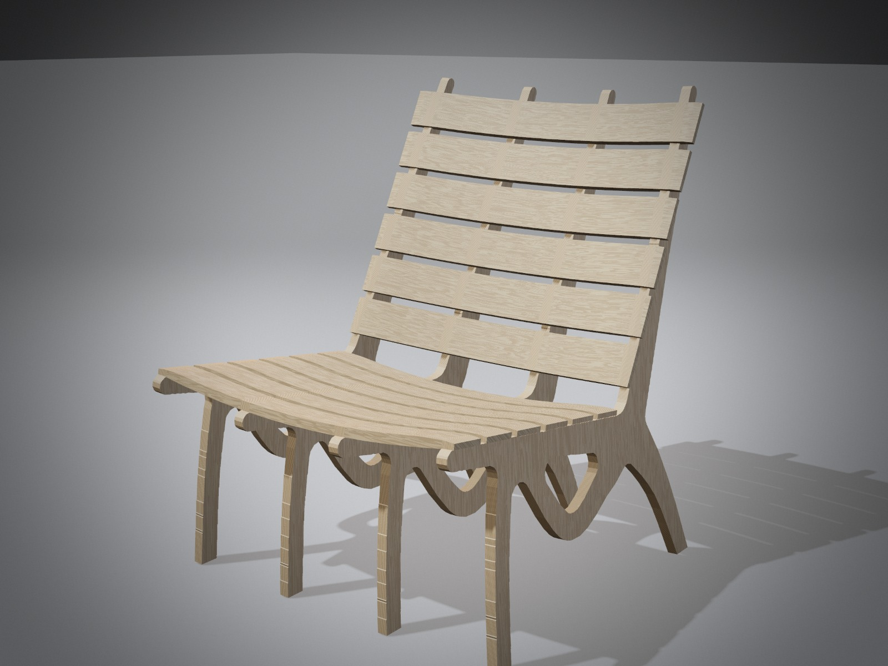
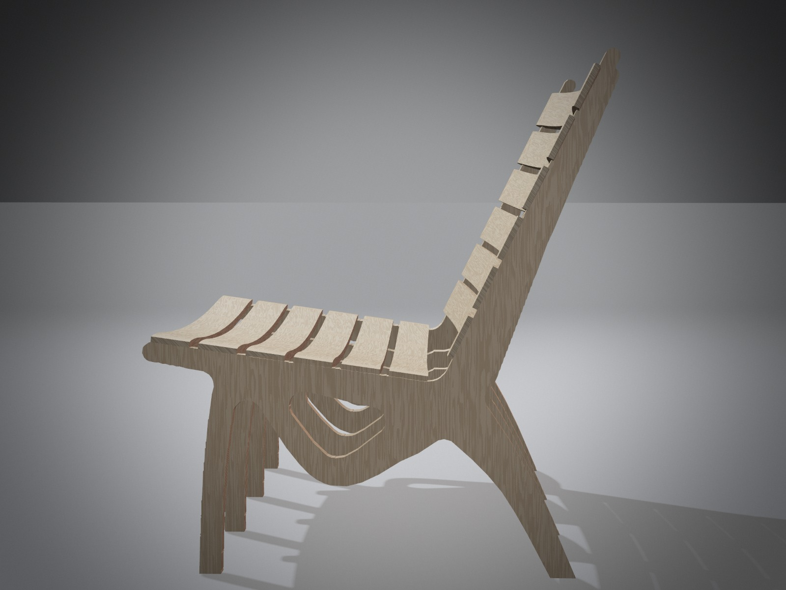
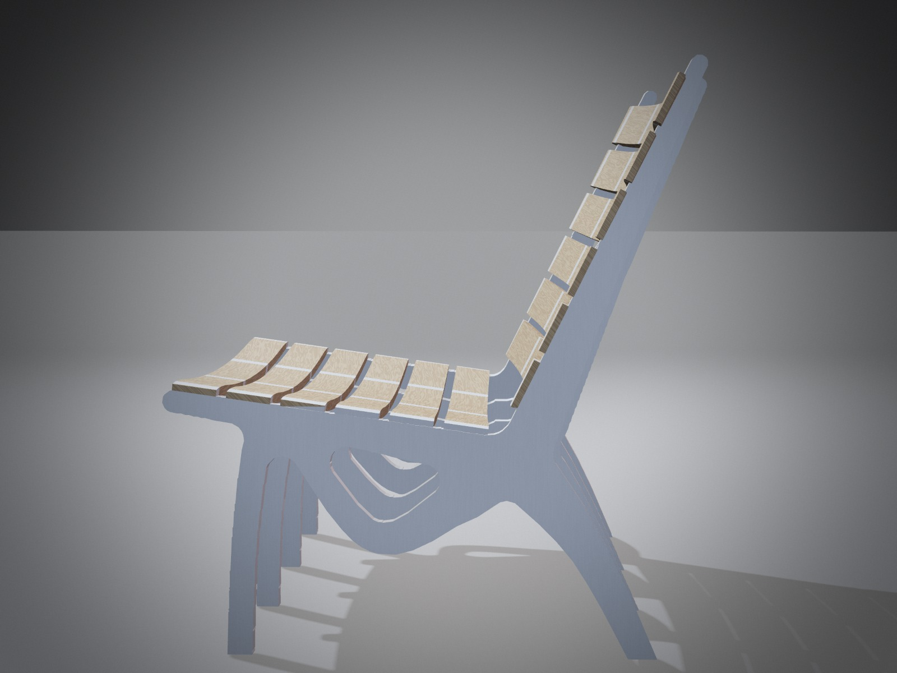
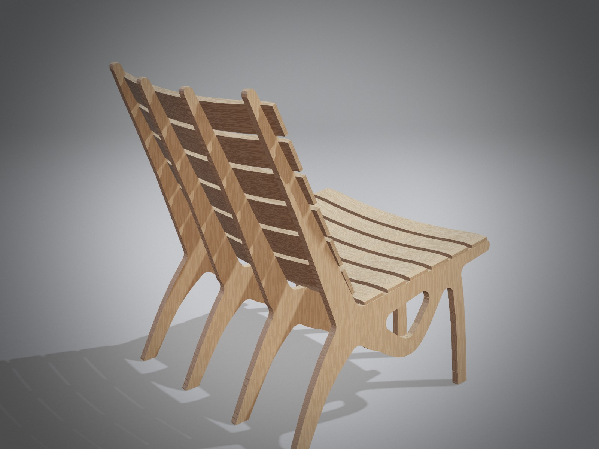

# Wooden lounge chair, four profiles

A low lounge chair in one gesture. In each profile an S-curve rises from the front foot, takes the front of
the seat, and swoops under it into a node at the seat-back corner. From that node a tendon runs down to the
rear foot and a single blade rises as the back, thinning to 22 mm at the top. Every member swells at the node
and thins to its ends. The four profiles fan out like ribs (4° and 1.5° each way, about seat height), the seat
dishes 25 mm and the back wraps 35 mm round you, and the bent ash slats thin to a blade at their ends.

| | |
|---|---|
| Size | about 650 wide at the floor (600 at the seat) × 760 deep × 805 high (mm) |
| Posture | seat 360 at the front, 300 at the rear (8° back); back reclined 26° |
| Weight | about 8.8 kg (profiles 4.4 kg, slats 4.4 kg) |
| Material | birch plywood 18 mm (profiles), ash bent laminate 15 mm (slats: seat 60 wide, back 70 wide) |

## Strength (ScriptCAD Analyze, whole chair, birch plywood)

| Load case | Stress in the members | Peak (at a junction) | Deflection | Margin over the design strength |
|---|---:|---:|---:|---:|
| Seated person: 1.6 kN on the seat, 0.5 kN on the back, over the middle 360 mm | 2.0 MPa | 4.6 MPa | 1.1 mm | 5.9× |
| Hard lean back: 0.6 kN on the top of the back | 3.1 MPa | 10.4 MPa | 2.1 mm | 2.6× |
| Sideways push: 0.3 kN across the seat, seat loaded 1.0 kN | 1.5 MPa | 3.6 MPa | 0.5 mm | 7.5× |

- **Design strength:** birch plywood in bending, 27 MPa (40 MPa characteristic, × 0.8 long-term, / 1.2 material).
- **The node:** the first version of this profile had 2.0× when leaning back; a thicker node at the seat-back
  corner brought it to 2.6×. The back is a cantilever from that node, so this is the case that sets the size.
- **Tipping backward (hand check):** the rear feet stand 180 mm behind the seat-back corner. With 600 N on the
  seat 175 mm in front of that corner and 80 N pushing back on the backrest (the loads of the EN 1022 rearward
  test), the restoring moment is about 210 N·m against about 50 N·m overturning.
- **Not modelled:** the joints themselves (the model joins slats and profiles solidly), plywood's different
  stiffness along and across the grain, creep. Test a prototype to EN 1728 / EN 12520 before a series.

## Making it

| Part | Material | Size (mm) | Qty | Notes |
|---|---|---|---|---|
| Profiles 1 and 4 (outer) | birch plywood 18 mm | `profile_1.dxf` (both the same) | 2 | fan out 4° about seat height; bevel the feet to match |
| Profiles 2 and 3 (inner) | birch plywood 18 mm | `profile_2.dxf` (both the same) | 2 | fan out 1.5°; the seat lower and the back deeper (the dish) |
| Seat slat | ash, bent laminate of 5 × 3 mm veneers | 15 × 60 × 600, 25 mm dish | 6 | one form: `forms.dxf`, lower curve; thin the last 60 mm to 9 mm |
| Back slat | ash, bent laminate of 5 × 3 mm veneers | 15 × 70 × 600, 35 mm dish | 6 | one form: `forms.dxf`, upper curve; thin the ends the same way |

- **Spacing:** profiles 194 mm apart at seat height, centre to centre.
- **Joints:** one 8 mm dowel and glue where each slat crosses a profile (48 dowels).
- **Grain:** face grain along the back blade, so the cantilever bends along the grain.
- **Edges and finish:** round all edges r = 4; hard-wax oil, or white lacquer on the profiles before assembly.
- **Open in ScriptCAD:** File → **Load wooden lounge chair, four profiles**, or open `calatrava_chair4.json`.

