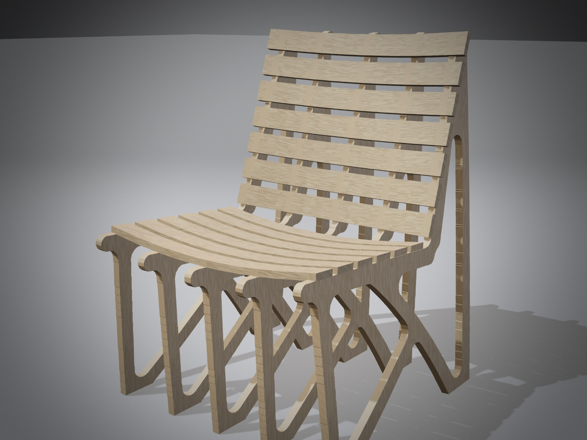
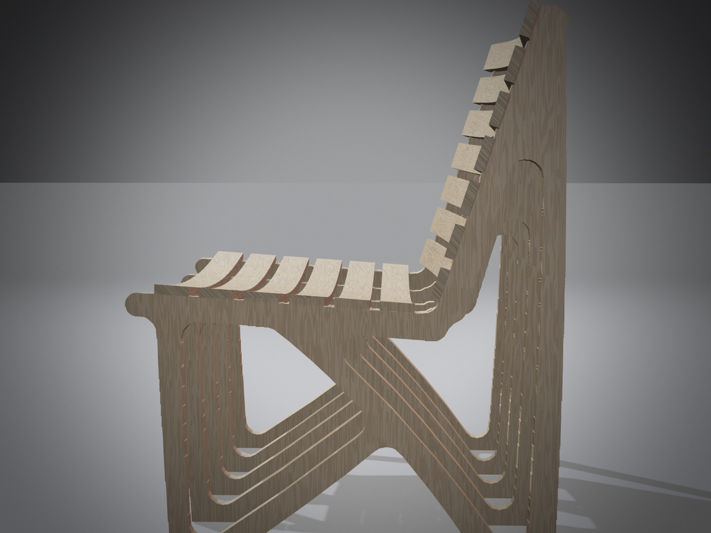
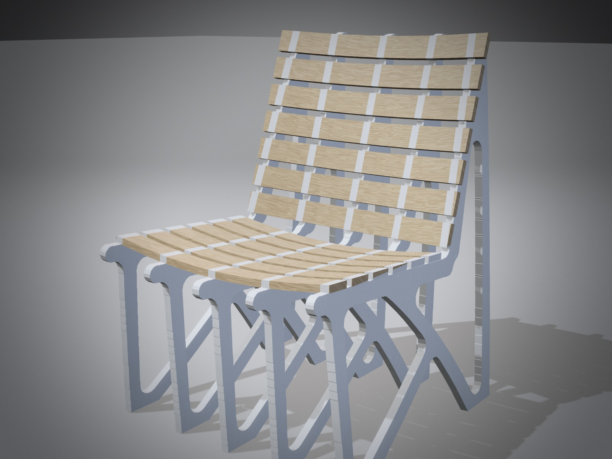
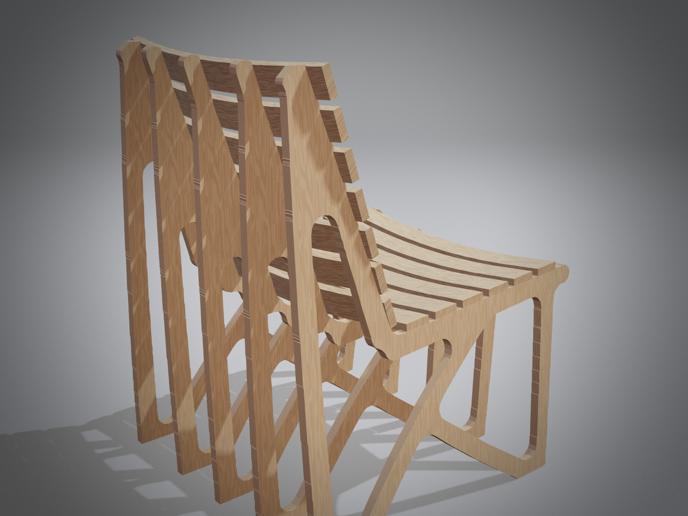
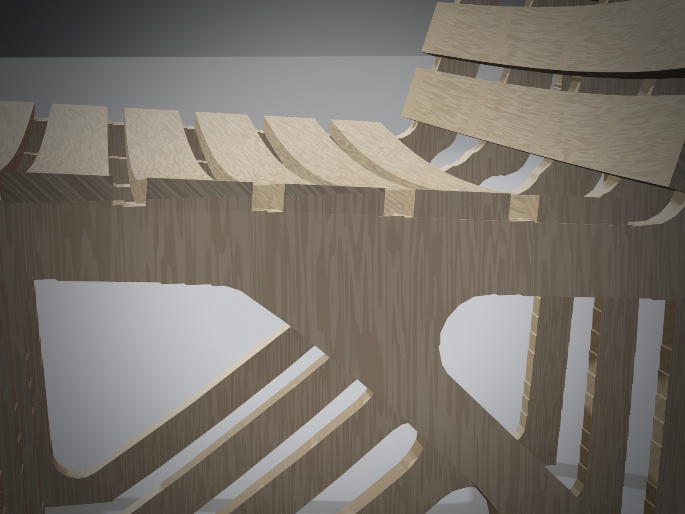

# Wooden lounge chair, five profiles

Five flat profiles stand in a row like ribs. Each one is a little different: the seat dips 25 mm at the
centre and the back wraps 35 mm round you, and every profile follows that dish where it stands, so the
middle one is the lowest and furthest back. The bent ash slats run across all five, and the two outer
profiles lean out 4° for a wider stance at the floor. Under the seat, a strut rises from the front foot to
the middle of the diagonal spine, so the side view crosses into an arch. The curvature is the shape the chair's own
deflection suggested (Analyze, strongly exaggerated), designed in on purpose.

| | |
|---|---|
| Size | about 615 wide at the floor (560 at the seat) × 680 deep × 834 high (mm); seat 405 at the front |
| Weight | about 10.5 kg (profiles 6.7 kg, slats 3.8 kg) |
| Material | birch plywood 18 mm (profiles), ash bent laminate 15 × 52 mm (slats) |

## Strength (ScriptCAD Analyze, whole chair, birch plywood)

| Load case | Stress in the members | Peak (at a junction) | Deflection | Margin over the design strength |
|---|---:|---:|---:|---:|
| Seated person: 1.6 kN on the seat, 0.5 kN on the back, over the middle 350 mm | 0.6 MPa | 1.3 MPa | 0.07 mm | 20.3× |
| Hard lean back: 0.6 kN on the top of the back | 1.6 MPa | 6.5 MPa | 0.8 mm | 4.1× |
| Sideways push: 0.3 kN across the seat, seat loaded 1.0 kN | 1.3 MPa | 3.4 MPa | 0.5 mm | 7.9× |

Design strength: birch plywood in bending, 27 MPa (40 MPa characteristic, × 0.8 long-term, / 1.2 material).
Five profiles carry the seat far more easily than two (20.3× instead of 6.8×). The front strut also
triangulates the space under the seat: leaning back, the case that counts, went from 2.6× to 4.1×. Not modelled: the joints themselves (the model
joins slats and profiles solidly), plywood's different stiffness along and across the grain, creep. Test a
prototype to EN 1728 / EN 12520 before a series.

## Making it

| Part | Material | Size (mm) | Qty | Notes |
|---|---|---|---|---|
| Profiles 1 and 5 (outer) | birch plywood 18 mm | `profile_1.dxf` (both the same) | 2 | lean out 4° about seat height; bevel the feet 4° so they stand flat |
| Profiles 2 and 4 | birch plywood 18 mm | `profile_2.dxf` (both the same) | 2 | |
| Profile 3 (middle) | birch plywood 18 mm | `profile_3.dxf` | 1 | the lowest seat, the deepest back |
| Seat slat | ash, bent laminate of 5 × 3 mm veneers | 15 × 52 × 560, 25 mm dish | 6 | all on one form: `forms.dxf`, lower curve |
| Back slat | ash, bent laminate of 5 × 3 mm veneers | 15 × 52 × 560, 35 mm dish | 7 | all on one form: `forms.dxf`, upper curve |

- **Spacing:** profiles 135.5 mm apart, centre to centre (the outer two measured at seat height).
- **Joints:** one 8 mm dowel and glue where each slat crosses a profile (65 dowels). Because the outer profiles lean in
  towards the top, the back slats overhang them a little at the top; trim or leave as a detail.
- **Grain:** cut the profiles with the face grain vertical (along the rear post).
- **Edges and finish:** round all edges r = 4, and finish with hard-wax oil. For the white version, lacquer the
  profiles before assembly.
- **Open in ScriptCAD:** File → **Load wooden lounge chair, five profiles**, or open `calatrava_chair5.json`.
  Analyze is set up with the ten feet as supports and the slats as the loaded faces.

